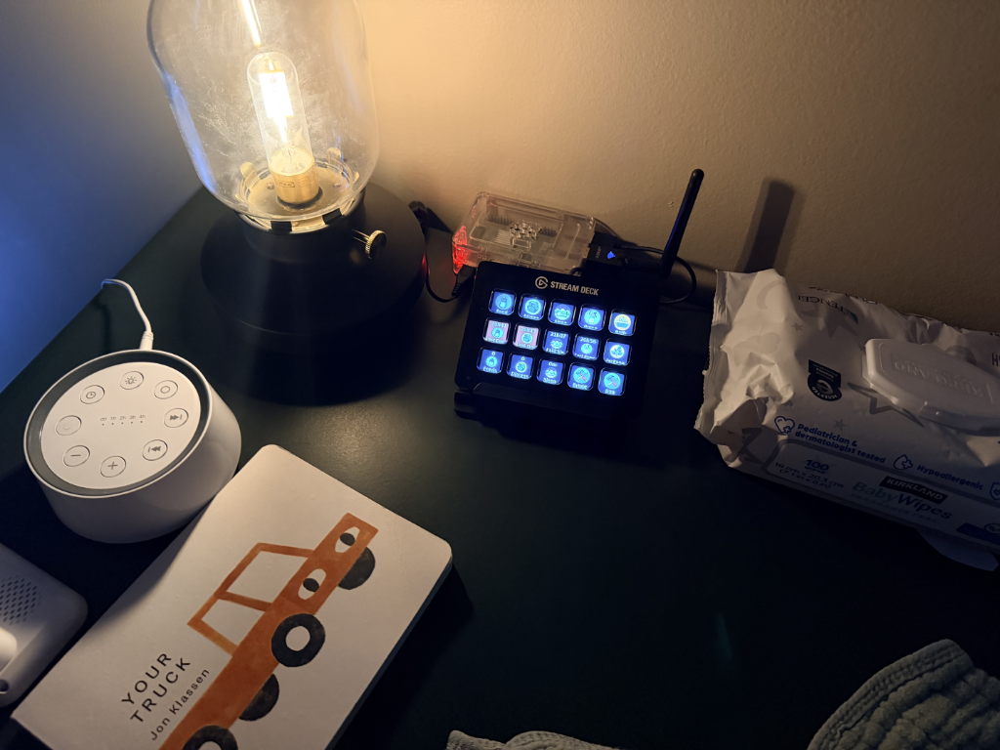
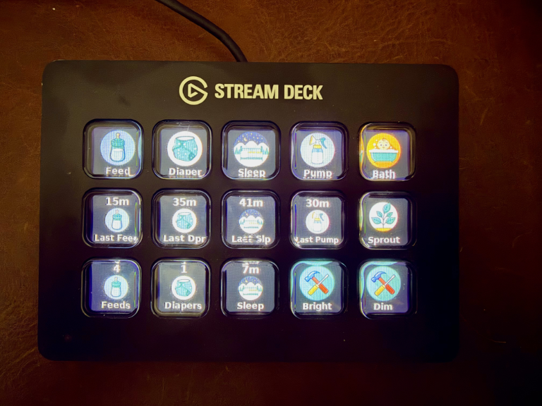

# Nursery Deck

An Elgato Stream Deck on a Raspberry Pi that logs baby care events to
[Sprout Track](https://github.com/Oak-and-Sprout/sprout-track) over its webhook API. Tap-to-log
nursery panel: big tactile actions plus live at-a-glance status.

Drives the deck raw over USB HID via `python-elgato-streamdeck` [here](https://github.com/abcminiuser/python-elgato-streamdeck). No Elgato
desktop software involved.

<div style="display: flex; gap: 12px; width: 100%;">
  
  
</div>

## Features

**Logging** — one press per common event, drill-in pages for detail:

- **Feed** — formula, breast milk, milk, and solids bottles with a ± oz stepper;
  left/right breastfeed timers that start, switch sides, and end
- **Diaper** — Wet / Dirty / Both in a single press, with optional blowout,
  condition, and colour modifiers that reset after each log
- **Sleep** — nap or night sleep with a location picker; one-press end
- **Pump** — one-press start; end screen captures per-side amounts
- **Bath** — type plus soap and shampoo toggles

**Live status** — the bottom rows are a read-only dashboard, polled every 30s:

- Time since last feed, diaper, sleep, and pump
- Today's feed count, diaper count, and total sleep
- Last-feed and last-diaper keys turn red when overdue, using the family's own
  warning thresholds
- Running feed, sleep, and pump timers tick every second between polls

**Shared timers** — feed and sleep sessions started on the deck are live in the
Sprout Track app and can be ended there, and vice versa.

**Multi-baby** — the sprout key shows the current baby and opens a switcher when
the API key sees more than one; the baby is resolved automatically at startup.

**Built for a nursery**

- Auto-dims on a night schedule (bright by day, dim overnight)
- Offline outbox with retry, so a press during a Wi-Fi blip still lands
- Survives reboots and deck unplugs via systemd; ~5% CPU on a Pi 2

## Deployment

Setup instructions: **[docs/IMPLEMENTATION.md](docs/IMPLEMENTATION.md)**.

Paths below assume the layout that guide produces, with `$USER` as the Pi's
user and `PI_HOST` as its hostname or address.

| | |
|---|---|
| App | `/home/$USER/nursery-deck/nursery_deck.py` |
| Icons | `/home/$USER/nursery-deck/assets/` |
| Config | `/home/$USER/nursery-deck/nursery-deck.env` (mode 600) |
| Virtualenv | `/home/$USER/deck-env` |
| Service | `nursery-deck.service` (enabled, starts at boot) |
| Hardware | Stream Deck Original V2, 15 keys (`0fd9:006d`) |
| OS | Raspberry Pi OS 13 (trixie), armv7l, Python 3.13 |

### Config

`ST_BASE_URL` is the bare host of your instance. A family slug is **not** part
of the API path — the key is already family-scoped, so
`https://your-host/your-family-slug/api/hooks/v1/...` returns a 404 HTML page.

### Operating

```bash
ssh $USER@PI_HOST
sudo systemctl status nursery-deck
sudo systemctl restart nursery-deck
sudo journalctl -u nursery-deck -f
```

### Deploying a change

Edit on the dev machine, then:

```bash
scp nursery_deck.py $USER@PI_HOST:~/nursery-deck/nursery_deck.py
ssh $USER@PI_HOST 'sudo systemctl restart nursery-deck'
```

## Pi setup

Full walkthrough in [docs/IMPLEMENTATION.md](docs/IMPLEMENTATION.md). The short
version:

```bash
sudo apt install -y python3-venv libhidapi-libusb0 fonts-dejavu-core \
                    libopenjp2-7 libtiff6 libwebp7 libfreetype6 libxcb1
python3 -m venv ~/deck-env
~/deck-env/bin/pip install streamdeck pillow requests
```

The gotchas worth knowing:

- PEP 668 blocks `pip3 install` into system Python — hence the venv. systemd
  `ExecStart` must use the venv's interpreter.
- `libhidapi-libusb0` is required; without it `DeviceManager().enumerate()`
  throws "no HID backend".
- The Pillow **wheel** does not bundle its shared libraries. Missing
  `libopenjp2-7` and `libfreetype6` produce `ImportError` at import and at
  first `truetype()` call respectively. Both are easy to misread as a missing
  Python package.
- udev rule at `/etc/udev/rules.d/10-streamdeck.rules` grants the `plugdev`
  group access to vendor `0fd9`. The default Raspberry Pi OS user is already in
  `plugdev`. `udevadm trigger` applied it without a replug.

## Rendering

Key faces are composited with Pillow: optional value badge on top, icon in the
middle, label on the bottom. Labels auto-shrink to fit the 72×72 key, so a long
location name stays readable. Keys with no icon (the `±` steppers, amount
readouts, Back) render large centred text instead. Selector keys share a font
ceiling via `Key.text_max` so a row of mixed-length labels reads evenly.

To preview pages without touching hardware, `render_key` takes any object with
a `key_image_format()` — see
[docs/IMPLEMENTATION.md](docs/IMPLEMENTATION.md#12-previewing-key-art-without-hardware).

## Performance

The loop repaints once a second so running timers tick smoothly, but keys are
diffed on their inputs `(page, icon, label, value, bg)` and only re-rendered
and re-uploaded when the face actually changes. On the Pi 2 this took sustained
CPU from ~24% to ~5%.

## API notes

Base: `{BASE_URL}/api/hooks/v1/babies/{BABY_ID}`

- `GET /status` every 30s (limit 60/min). Between polls, running timers tick
  locally off cached `leftDuration`/`rightDuration` and reconcile on the poll.
- `POST /activities` for all logging (limit 30/min).
- `GET /reference` is no longer called at runtime. It was used to resolve
  medicine names; with medicine logging removed, the only reference data left
  is the sleep location list, which is pinned in `SLEEP_LOCATIONS`.
- Writes are queued in an outbox with exponential backoff (2s → 60s, 20
  attempts) so a 3am press during a wifi blip still lands. 4xx responses are
  treated as permanent and dropped rather than retried — retrying a rejected
  payload only burns the rate limit.
- After any write the poller re-polls immediately rather than waiting out the
  30s cycle, so a Sleep/Breast key reflects its new state right away.

Breastfeed timers share the same live session as the in-app timer: a nurse
started at the dresser shows as active on a phone in the next room. On the Feed
page, pressing the *active* side ends the session; pressing the *other* side
switches sides.

## Layout

15 keys, 5 × 3.

**Home** — three bands:

```
Feed      Diaper    Sleep     Pump      Bath     <- actions
LastFeed  LastDpr   LastSlp   LastPump  sprout   <- how long ago
Feeds     Diapers   Sleep     Bright    Dim      <- today so far
```

Sleep and Pump turn green while running. Sleep ends in one press; when nothing
is running it opens the Sleep picker. Pump starts in one press and opens the
amount screen to end.

`LastFeed` and `LastDpr` turn amber-red when `GET /status` reports
`warnings.feedOverdue` / `diaperOverdue`. Those thresholds are the family's own
(`feedWarningTime`, `diaperWarningTime`), not a guess made here.

**Pump** — press Pump to start the timer; press again to open the end screen:

```
 L −    L 2.5    L +     ·     Back
 R −    R 3.0    R +     ·      ·
End, no amt   TOTAL 5.5 oz     SAVE
```

`Back` cancels and leaves the timer running — only `SAVE` and `End, no amt`
close the session.

Amounts are stored per side. A bare `amount` field is accepted with 200 and
then silently discarded, and `totalAmount` is derived server-side and cannot be
written directly — so both sides are entered here and the server computes the
total. A side left at zero is omitted from the payload rather than sent as `0`,
since a recorded zero is not the same as "not measured"; that is what
`End, no amt` produces for both sides.

**Sleep** — Nap / Night on the top row, six locations below, `START` bottom
right. Nothing is written until `START`; the selected type and location are
highlighted in blue, distinct from the green used for a running timer. The
selection is sticky, so repeating the same kind of sleep is one extra press.

Key labels are shortened to fit ("Parents", "Car Seat") but the POST carries
the canonical value from `GET /reference?type=sleep-locations` — sending the
shortened label would silently fail to match. The reference list also contains
an `Other` catch-all and a `CAR_SEAT` duplicate of `Car Seat`; both are
deliberately omitted. See `SLEEP_LOCATIONS`.

**Feed** — Formula, Breast L, Breast R, Solids, Back / Bottle BM, Milk, −oz,
+oz, amount.

**Diaper** — Wet, Dirty, and Both log in **one press**; it is the
highest-frequency action and stays that way:

```
Wet    Dirty   Both  Blowout  Back
Normal Loose   Firm    ·       ·
Yellow Brown   Green  Black   Red
```

Blowout, condition, and colour are optional modifiers set *before* the type
key, and reset after every log so the next press is a plain diaper again.
Pressing a selected value again clears it. Unset condition/colour are omitted
from the payload entirely.

`condition` and `color` are unvalidated free-form strings with no `/reference`
endpoint, so `DIAPER_CONDITIONS` and `DIAPER_COLORS` mirror the app's dropdowns,
upper-cased to match what the app stores. The app's `Other` option is omitted —
a key labelled "Other" carries no information later. The app's "Diaper Cream
Applied" checkbox has no webhook API field at all; see
[docs/webhook-api.md](docs/webhook-api.md).

**Babies** — the sprout key shows the current baby's name. With more than one
baby visible to the key it opens a switcher; with one it does nothing. Babies
are resolved from `GET /babies` at startup, so `ST_BABY_ID` is optional — if
unset, the first baby is used. Switching repoints the client, drops the cached
status, and forces an immediate re-poll so no counts bleed between babies.

**Bath** — type on the top row, soap and shampoo as independent on/off toggles,
`LOG` bottom right:

```
Full   Sponge   Wipe    ·     Back
Soap   Shampoo   ·      ·      ·
 ·        ·      ·      ·     LOG
```

`bathType` is free-form with no `/reference` endpoint, so `BATH_TYPES` mirrors
the app's own dropdown. The app's fourth option, `Custom`, is omitted: it exists
to let you type a name, and the deck has no keyboard — sending the literal
string `"Custom"` would store a meaningless type.

`soapUsed` and `shampooUsed` default to `true` server-side, so both are always
sent explicitly rather than omitted when off. Selection is sticky, as on the
Sleep page.

## Scope

The deck logs feeds, diapers, sleep, pump, and bath. Medicine, supplements,
notes, measurements, milestones, vaccines, play, and photos were deliberately
removed — they are better handled in the app, and cutting them freed the Home
page for live status.

`assets/` carries only the ten icons still in use; the rest are available from
Sprout Track's `public/` folder if a flow is reinstated. Note that medicine and
supplement logging matches on names from `GET /reference`, so restoring either
means restoring the startup reference fetch that resolved them.

## Known API constraints

Behaviors worth knowing before extending this, all verified against a live
instance: see [API behavior worth knowing](docs/IMPLEMENTATION.md#14-api-behavior-worth-knowing)
in the implementation guide, and [docs/webhook-api.md](docs/webhook-api.md) for
the full API reference.
